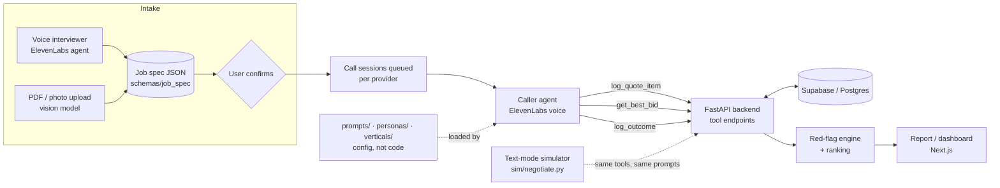

# The Negotiator

**Voice agents that call service providers, collect itemized quotes, negotiate with real leverage, and rank the results — with a built-in honesty line.**

Built in 24 hours for the **ElevenLabs challenge at the Hack-Nation 6th Global AI Hackathon** (July 2026). The shipped vertical is **home cleaning**; the architecture is vertical-agnostic (a second vertical, local moving, exists as a config file).

`Python · FastAPI · OpenAI · ElevenLabs Agents · Supabase/Postgres · Next.js 14 · TypeScript · Tailwind`

---

## The problem

Service quotes are hard to compare: different scopes, hidden add-ons, "introductory" lowball prices that grow on the day of the job. Nobody has the time to call five providers, decode their fees, and negotiate. The Negotiator does that on the customer's behalf and shows the evidence.

## What it does

1. **Intake — two paths, one confirmed spec.** A voice interviewer *or* an uploaded quote/photo (PDF, JPG, PNG, WebP → vision model) produces the same job-spec JSON. The user reviews and confirms it before any call is queued.
2. **Calls.** For every provider, a caller agent discloses that it is an AI, reads the exact spec, and logs each price component as a structured line item *while the call is still running*.
3. **Negotiation with real leverage.** After the first itemized quote, the agent can cite the best competing bid — only through the `get_best_bid` tool, at the exact amount, and never if no bid exists.
4. **Red-flag engine + ranking.** Quotes are checked against rule-based red flags (30 %+ below market, uncapped hourly rate, refusal to itemize, cash-only, standard clean for a long-neglected home) and ranked: valid quotes first, flagged quotes demoted, then by price.
5. **Report.** A ranked comparison with itemized fees, red-flag reasons, price movement ("moved from $2,000 to $1,850 because of a cited competing bid"), and links to transcript/recording.



## Engineering decisions worth knowing about

| Decision | Why it matters |
|---|---|
| **Honesty enforced structurally, not only by prompt.** The agent can only learn about competing bids through the `get_best_bid` tool, which reads the quotes DB. If no bid exists it returns `null` and the agent must not mention one. | A voice agent that bluffs is a liability. The guarantee does not depend on the LLM "behaving". |
| **Prompts, personas and vertical config are files.** Agents load `prompts/*.md` and `verticals/*.yaml` at runtime. | Conversation design can change agent behavior with a merged PR and zero code. Swapping the vertical means swapping a YAML file. |
| **JSON Schemas are the contract.** `job_spec.schema.json` and `quote.schema.json` are shared by both intake paths, the backend, the ElevenLabs tools and the dashboard. | Four people built in parallel against one agreed interface from hour 1. |
| **Text-first, voice-swappable.** `sim/negotiate.py` runs the same prompt, the same three tools and a persona-playing second model, entirely in text. | Voice minutes were the scarce resource. Prompt iteration cost about $0.03–0.05 per run instead of burning call credits. |
| **Every call ends in exactly one structured outcome**: `quote`, `callback` (named contact + time window), or `declined`. | "They said around two hundred" counts as a failed call. |
| **Document intake never guesses.** The extraction prompt forbids invented values; unknown fields go into `open_questions` and the result is only ever a *draft* the user must confirm. Uploads are validated for type and capped at 20 MB. | Wrong specs would poison every downstream quote. |

## Results from the text-mode simulator

First live sweep, 2026-07-18. Caller `gpt-4.1`, counterparty personas `gpt-4o-mini`. These runs were made on the **local-moving prototype** of the personas (see "Status and known gaps"); the logic under test — itemization, leverage, red flags, disclosure — is vertical-independent.

| Persona | What happened |
|---|---|
| **Lowballer** | Opened at $1,100 "all-in". The agent extracted the hidden $250 stairs fee (real price ≈ $1,350) and the lowball red flag fired (36 % below market). |
| **Upseller** | Price moved **$2,000 → $1,850** after the agent cited the real competing bid. Upsell declined; agent refused to book. |
| **Tough negotiator** | Price moved **$2,400 → $2,160** plus a $200 fuel waiver for a weekday date, per the persona's hidden concession rule. |
| **Stonewaller** | "We don't quote over the phone" → call ended with a structured `callback_commitment` (name + time window). |

A full run costs about $0.03–0.05; the four-persona sweep is under $0.20. The first sweep also found a real defect — the tough negotiator got no negotiation attempt — which led to a prompt fix (negotiation became mandatory). Raw transcripts and structured records are in [`sim/runs/`](sim/runs/).

## Evaluation

[`evals/golden-calls.md`](evals/golden-calls.md) defines **10 pass/fail golden-call cases** (fee extraction under evasion, lowball red flag, AI disclosure when asked "are you a robot?", no-bluff check on an empty bid DB, exact-amount leverage, stonewall exit, interruption recovery, spec fidelity across calls, scope defense, structured ending). Cases 2, 3, 5 and 10 are the **demo gate**: they must pass before any demo recording. The simulator prints an automatic summary per run (outcome, price movement, red flags, disclosure check, cost).

## Tech stack

| Layer | Tech |
|---|---|
| Voice agents | ElevenLabs Agents (interviewer + caller), tools wired by API (`elevenlabs/create_agents.py`, `configure_live.py`) |
| Backend | Python, FastAPI, Pydantic, Uvicorn, PyYAML; 15 REST routes incl. the ElevenLabs tool endpoints |
| LLM | OpenAI (`gpt-4o` for document intake, `gpt-4.1` caller in the simulator) |
| Data | Supabase / Postgres (specs, companies, calls, quotes, quote_items; schema in `backend/db/schema.sql`) |
| Frontend | Next.js 14, React 18, TypeScript, Tailwind CSS, Framer Motion; pages for upload, processing, review, negotiation board, report, per-company and transcript views |
| Contracts | JSON Schema (draft 2020-12) |

## Team

Built by four people in 24 hours.

| Who | Role | Owns |
|-----|------|------|
| A | Frontend | `frontend/` — intake/spec confirmation, live call board, ranked report |
| B | Backend / orchestrator | `backend/`, tool endpoints, red-flag + ranking engine |
| **Alex Müller** | **Conversation design + ElevenLabs configuration** | `prompts/`, `personas/`, `verticals/`, `evals/`, `demo/`, `docs/`, `sim/`, `elevenlabs/` setup, agent creation via API, text-mode simulator and live eval sweep |
| D | Voice integration + document intake | ElevenLabs tool wiring, web-call sessions, photo/PDF → job spec |

Development used AI coding assistance (Claude Code). Commits made with it carry a `Co-Authored-By` trailer.

## Run it

1. Copy `.env.example` to `.env` and fill in the OpenAI key and the Supabase URL/service key (backend only — never in a `NEXT_PUBLIC_*` variable). Create the tables with `backend/db/schema.sql`.
2. Backend:
   ```bash
   python3 -m venv .venv
   .venv/bin/pip install -r backend/requirements.txt
   .venv/bin/uvicorn backend.main:app --reload --port 8000
   ```
3. Frontend (`frontend/the-negotiator`): set `NEXT_PUBLIC_API_BASE_URL=http://localhost:8000` (mocks are opt-in via `NEXT_PUBLIC_USE_MOCKS`), then `npm install && npm run dev`.
4. Walk the flow: upload a PDF/image → review and confirm the generated spec → call board → report.
5. **Voice calls** need a publicly reachable backend (deploy or ngrok) and the tool URLs updated in the ElevenLabs agents: see [`elevenlabs/tools.md`](elevenlabs/tools.md) and [`elevenlabs/setup.md`](elevenlabs/setup.md).
6. **No ElevenLabs credits? Use the text simulator:**
   ```bash
   python3 -m pip install --user openai
   python3 sim/negotiate.py personas/tough-negotiator.md
   ```
   See [`sim/README.md`](sim/README.md). End-to-end backend check without voice: `backend/test_loop.py`.

## Repo layout

```
prompts/      system prompts for the interviewer and caller agents
personas/     role-player cards with hidden price floors and concession rules
verticals/    per-vertical config (cleaning shipped, moving as second example)
schemas/      job spec + quote JSON schemas — the contract
evals/        10-case golden-call checklist
sim/          text-mode negotiation simulator + recorded runs
demo/         3-minute demo script mapped to the judging criteria
docs/         how the four mandatory conversation requirements are handled
elevenlabs/   agent/tool setup, creation and configuration scripts
backend/      FastAPI orchestrator, tool endpoints, red-flag + ranking engine
frontend/     Next.js dashboard
PLAN.md       the 24-hour plan: hour-0 decisions, credit contingency, timeline, scope traps
```

## The four conversation requirements

The brief required these to be handled explicitly; [`docs/conversation-requirements.md`](docs/conversation-requirements.md) is the source of truth.

1. **Who is the agent speaking for?** It discloses on open that it is an AI assistant calling for a customer. Asked "are you a robot?", it confirms plainly and keeps the call going.
2. **How does it survive friction?** Short turns, barge-in tolerated, resume after interruptions, vague answers pushed to itemization at most twice, "someone will call back" converted into a named callback window.
3. **Where is the honesty line?** Only real bids at their exact amount, fetched at the moment of use; never invents home details, never fakes a bid, never books anything.
4. **How does every call end?** One `log_outcome` with a structured result.

## Status and known gaps

This is a hackathon prototype, stated honestly:

- **Vertical switch.** The product shipped with home cleaning. The personas, the simulator runs in `sim/runs/` and parts of `PLAN.md` come from the earlier local-moving direction, so their dollar figures are moving-job figures. `verticals/moving.yaml` is kept as the proof that a vertical is a config file.
- **Known eval gap:** in the first sweep the lowballer's second hidden fee ($150 fuel/materials) was not extracted and the cash-deposit demand was not logged as a condition, so that red flag did not fire (golden-call case 1).
- **Not built on purpose:** real phone calls to real businesses, agent-to-agent audio, live places search, auth, mobile. Calls were played against teammates role-playing the personas.
- The golden-call checklist is run by hand plus the simulator's automatic summary; it is not yet a CI test suite.
